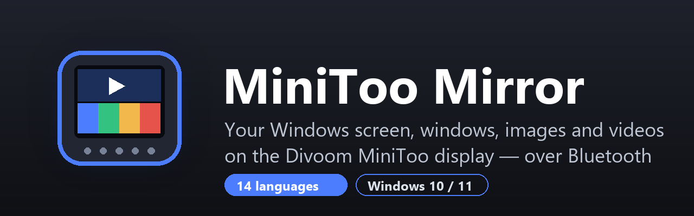
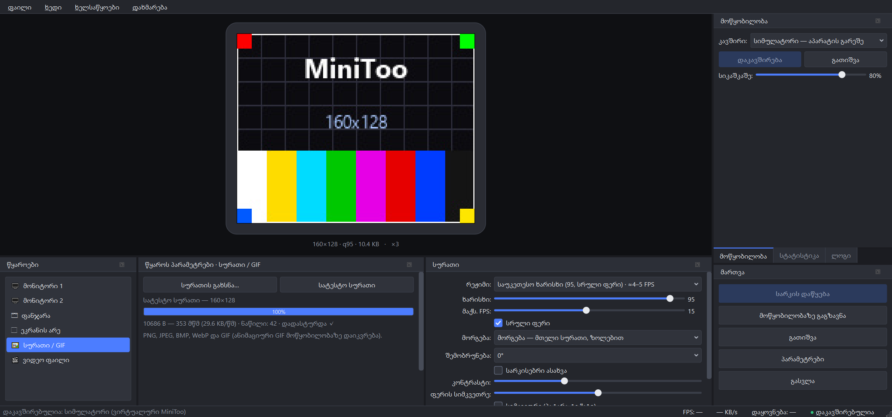

<p align="center">
  
</p>

<p align="center">
  <a href="README.md">English</a> · <b>ქართული</b>
</p>

**MiniToo Mirror** Windows-ის ეკრანს აჩვენებს **Divoom MiniToo**-ს პატარა ეკრანზე. ეს შეიძლება იყოს:
- მთელი მონიტორი;
- ერთი ფანჯარა;
- ეკრანის ნაწილი;
- სურათი ან ანიმაციური GIF;
- ვიდეო ფაილი.

პროგრამა მუშაობს Bluetooth-ით, დინამიკის ჩვეულებრივ firmware-ზე. firmware არ იცვლება.

> არაოფიციალური პროექტია, Divoom-თან კავშირი არ აქვს.

<p align="center">
  
</p>

## ჩამოტვირთვა

ბოლო ვერსია **[Releases](../../releases/latest)** გვერდზეა:

| ფაილი | რა არის |
|---|---|
| `MiniTooMirror-Setup-x.y.z.exe` | **ინსტალატორი** (რეკომენდებული). ამატებს მენიუს ჩანაწერს, სურვილისამებრ დესკტოპის ხატულას და დეინსტალატორს. ინსტალაციისას პროგრამის ენასაც ირჩევ. ადმინის უფლებები საჭირო არ არის. |
| `MiniTooMirror-x.y.z-portable.zip` | **Portable**: გახსენი ნებისმიერ საქაღალდეში და გაუშვი `MiniTooMirror.exe`. |

Windows SmartScreen შეიძლება გაგაფრთხილოს „უცნობ გამომცემელზე“, რადგან პროგრამას ციფრული ხელმოწერა არ აქვს. დააჭირე *More info → Run anyway*.

## შესაძლებლობები

- **წყაროები:**
  - ნებისმიერი მონიტორი;
  - ერთი ფანჯარა, სხვა ფანჯრით დაფარულიც;
  - ეკრანის არე, რომელსაც მაუსით მონიშნავ;
  - სურათი ან GIF;
  - ვიდეო.
- **ვიდეო ორი გზით:**
  - პირდაპირი ჩვენება, დაახლოებით 3–5 განახლება წამში;
  - მოკლე კლიპის ატვირთვა ანიმაციად. ასეთ კლიპს MiniToo თავად უკრავს, გლუვად და განმეორებით.
- **სურათის დამუშავება:**
  - მორგება, შევსება (ჩამოჭრით) ან გაწელვა;
  - შემობრუნება და სარკისებრი ასახვა;
  - კონტრასტი, ფერი და სიმკვეთრე;
  - მაუსის ისარი;
  - JPEG ხარისხი 100-მდე, სრული ფერით (4:4:4).
- **წინასწარი ხედი:** ჩანს ზუსტად ის, რაც მოწყობილობაზე მიდის.
- **სტატისტიკა:** განახლება წამში, KB/წმ, დაყოვნება, კადრის ზომა.
- **საიმედოობა:**
  - სიჩქარის ავტომატური შერჩევა;
  - დაკარგული ნაწილის ხელახლა გაგზავნა;
  - კავშირის ავტომატური აღდგენა;
  - უცვლელი კადრის გამოტოვება.
- **14 ენა**, მათ შორის ქართული. მუქი თემა, პანელები, რომლებსაც თავისუფლად გადაადგილებ.

## დაწყება

1. **ერთხელ დააწყვილე დინამიკი:**
   - Windows Settings → Bluetooth & devices → Add device → Bluetooth → **Divoom MiniToo-Audio**;
   - მანამდე ტელეფონზე დახურე Divoom-ის აპლიკაცია ან გამორთე Bluetooth, რადგან დინამიკი ერთდროულად მხოლოდ ერთ კავშირს იღებს.
2. **დააყენე და გაუშვი** MiniToo Mirror.
3. „**მოწყობილობა**“ → *Divoom MiniToo-Audio* → „**დაკავშირება**“. ქვედა ზოლში მწვანე „დაკავშირებულია“ უნდა გამოჩნდეს.
4. ქვემოთ, მარცხნივ, აირჩიე **წყარო** და დააჭირე „**სარკის დაწყება**“. სურათისთვის დააჭირე „**მოწყობილობაზე გაგზავნა**“.

160×128 ეკრანზე პატარა არე (ერთი პანელი, საათი, ჩატი) ბევრად უფრო მკვეთრად ჩანს, ვიდრე მთელი მონიტორი.

## სიჩქარე

გაზომილია ნამდვილ MiniToo-ზე, მთელი 1920×1080 ეკრანის სარკით:

| რეჟიმი | კადრი | განახლება / წმ | დაყოვნება* |
|---|---|---|---|
| საუკეთესო ხარისხი (95, სრული ფერი) | ~7.6 KB | **~4.7** | ~320 მწმ |
| ბალანსი (80) | ~3.5 KB | **~7.2** | ~230 მწმ |

\* გადაღებიდან მოწყობილობის დადასტურებამდე. აქ არ შედის დრო, რომელიც დინამიკს თავად სჭირდება კადრის საჩვენებლად.

MiniToo-ს **ვიდეო-ნაკადის რეჟიმი არ აქვს**. ყოველი კადრი ცალკე სურათად იტვირთება, Bluetooth კი წამში დაახლოებით 35–40 KB-ს ატარებს. ამიტომ რეალისტური მაქსიმუმი რამდენიმე განახლებაა წამში.

## USB კაბელი

კაბელით შეერთებისას MiniToo Windows-ს უჩენს მხოლოდ:
- ხმას: დინამიკი და მიკროფონი „Divoom Audio“;
- მედია-ღილაკებს;
- ბარათის წამკითხველს.

**ეკრანისთვის მონაცემების არხი USB-ზე არ არის**, ამიტომ სურათი ყოველთვის Bluetooth-ით მიდის. ეს ნამდვილ აპარატზე შემოწმდა.

კაბელი სასარგებლოა კვებისთვის, განსაკუთრებით ხანგრძლივი სარკისას. თუ კომპიუტერის ხმა MiniToo-ზე უკრავს, დინამიკმა სურათის ნაცვლად შეიძლება ხმის ვიზუალიზაცია აჩვენოს.

## უსაფრთხოება

- პროგრამა მოწყობილობას მხოლოდ **ორ ბრძანებას** უგზავნის: სურათის ატვირთვას (`0x8B`) და სიკაშკაშეს (`0x74`).
- ყველა სხვა ბრძანება კოდში დაბლოკილია, მათ შორის ის, რომლებიც მოწყობილობას ყინავს ან თიშავს.
- ატვირთვა შეზღუდულია 400 KB-ით, რადგან 763 KB-იან ატვირთვაზე მოწყობილობა გადაიტვირთა.
- firmware არასდროს იცვლება.

## პრობლემები

| პრობლემა | რა ვცადოთ |
|---|---|
| შეცდომა 10051 / 10065 (მიუწვდომელია) | ჯერ დააწყვილე MiniToo Windows-ში. |
| შეცდომა 10060 / 10061 (ვადა გავიდა / უარყო) | დახურე Divoom-ის აპი ტელეფონზე ან გამორთე ტელეფონის Bluetooth. MiniToo გამორთე და ჩართე, დადე ახლოს. |
| დაკავშირდა, მაგრამ სურათი არ ჩანს | გაგზავნე **სატესტო სურათი** (წყარო „სურათი / GIF“). შეამოწმე, რომ დინამიკზე მუსიკა არ უკრავს. |
| სურათი ზიანდება | პარამეტრები → გადაცემა: „პაუზა ნაწილებს შორის“ დააყენე 20 მწმ და გამორთე ავტომატური სიჩქარე. |
| ფანჯარა შავია | წყაროს პარამეტრები → გადაღება: „ეკრანიდან“. |
| ძალიან ნელია | რეჟიმი: „ბალანსი“ ან „ყველაზე სწრაფი“. ან აირჩიე პატარა არე. |

**ხელსაწყოები → დიაგნოსტიკა** ამოწმებს ადაპტერს, დაწყვილებას, გადაღებას და სიჩქარეს. კონსოლური `MiniTooDiagnose.exe` ქმნის ფაილს `diagnostic_report.txt`.

ლოგი და პარამეტრები ინახება საქაღალდეში `%APPDATA%\MiniTooMirror`.

## წყაროდან აწყობა

საჭიროა Windows 10/11 და Python 3.10+:

```bat
install.bat        :: ქმნის .venv-ს და აყენებს პაკეტებს
start.bat          :: პროგრამა (start.bat --simulator — აპარატის გარეშე)
run_tests.bat      :: ტესტები
build.bat          :: ტესტები -> EXE -> ინსტალატორი (Inno Setup 6) -> portable ZIP
```

## ლიცენზია

[MIT](LICENSE). „Divoom“ და „MiniToo“ მათი მფლობელის სავაჭრო ნიშნებია.
