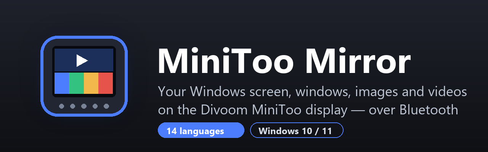
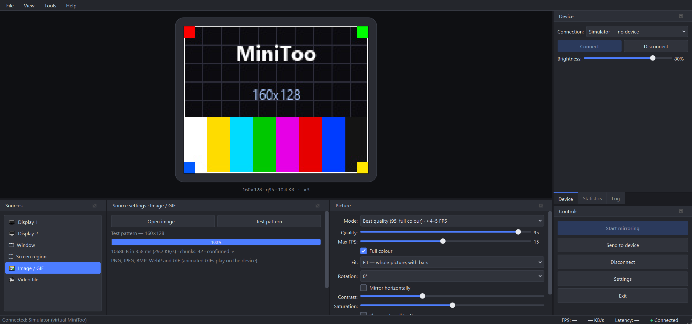

<p align="center">
  
</p>

<p align="center">
  <a href="../../releases/latest"></a>
  
  
  <a href="LICENSE"></a>
</p>

<p align="center">
  <b>English</b> · <a href="README.ka.md">ქართული</a>
</p>

**MiniToo Mirror** shows your Windows screen on the little LCD of the **Divoom MiniToo** Bluetooth speaker: the whole display, one window, a region of the screen, a picture, an animated GIF or a video file.

It works on the speaker's normal firmware over Bluetooth. Nothing is flashed or modified.

> Unofficial project, not affiliated with or endorsed by Divoom.

<p align="center">
  
</p>

## Download

Get the latest version from **[Releases](../../releases/latest)**:

| File | What it is |
|---|---|
| `MiniTooMirror-Setup-x.y.z.exe` | **Installer** (recommended). Start menu entry, optional desktop icon, uninstaller, and a choice of program language during setup. No admin rights needed. |
| `MiniTooMirror-x.y.z-portable.zip` | **Portable**: unzip anywhere and run `MiniTooMirror.exe`. |

Windows SmartScreen may warn about an unknown publisher, because the program is not code-signed. Click *More info → Run anyway*.

## Features

- **Sources:** each display, a single window (even when it is covered), a screen region you drag on a screenshot, an image or GIF, and video files.
- **Video:** two ways to show it.
  - Play it live, at about 3–5 updates per second.
  - Upload a short clip as an animation that the MiniToo plays by itself, smoothly and in a loop.
- **Picture:**
  - Fit, fill (crop) or stretch.
  - Rotation and mirroring.
  - Contrast, saturation and sharpening.
  - Mouse pointer.
  - JPEG quality up to 100 with full-colour (4:4:4) encoding.
- **Live preview** of exactly the pixels that are sent, with the JPEG artefacts included.
- **Statistics:** updates per second, KB/s, latency, frame size and transfer pause.
- **Reliability:**
  - Automatic speed tuning.
  - Re-sending of missed chunks.
  - Automatic reconnection.
  - Unchanged frames are skipped to save Bluetooth bandwidth.
- **Interface:** dock-based layout you can rearrange, dark theme, settings window.
- **14 languages:** English, ქართული, Deutsch, Français, Español, Italiano, Português (Brasil), Polski, Türkçe, Українська, Русский, 简体中文, 日本語, 한국어.
- **Tools:** built-in diagnostics and a console diagnostic tool.

## Getting started

1. **Pair the speaker once.**
   - Windows Settings → Bluetooth & devices → Add device → Bluetooth → **Divoom MiniToo-Audio**.
   - Close the Divoom app on your phone first, or turn the phone's Bluetooth off: the speaker accepts one connection at a time.
2. **Install and start** MiniToo Mirror.
3. In **Device**, choose *Divoom MiniToo-Audio* → **Connect**. The status bar turns green.
4. Pick a **source** (bottom left) → **Start mirroring**. For an image, use **Send to device** instead.

A small region (one panel, a clock, a chat) looks far sharper on the 160×128 screen than a whole 1080p display.

## Performance

Measured on a real MiniToo, mirroring a whole 1920×1080 display:

| Mode | Frame size | Updates / s | Latency* |
|---|---|---|---|
| Best quality (JPEG 95, full colour) | ~7.6 KB | **~4.7** | ~320 ms |
| Balanced (JPEG 80) | ~3.5 KB | **~7.2** | ~230 ms |

\* From capture to the device's confirmation. The time the speaker itself needs to show the frame is not included.

The MiniToo has **no video-streaming mode**. Every frame is a complete image upload: start, then 256-byte chunks, then an acknowledgement. The Bluetooth link carries about 35–40 KB/s, so a few updates per second is the realistic limit.

## USB cable

Over USB the MiniToo only offers audio (a speaker and microphone named "Divoom Audio"), media keys and a card reader. **There is no data channel for the screen over USB**, so pictures always travel over Bluetooth. This was checked on a real device.

The cable is still useful for power during long sessions. If the PC's sound plays through the MiniToo, the speaker may show its own sound visualizer instead of the picture.

## Safety

- The program only ever sends **two commands**: picture upload (`0x8B`) and brightness (`0x74`). Every other command is blocked in code, including the ones known to freeze or crash the device.
- Uploads are capped at 400 KB. A 763 KB upload is known to reboot the device.
- The firmware is never touched.

## Troubleshooting

| Problem | Try |
|---|---|
| Error 10051 / 10065 (device unreachable) | Pair the MiniToo in Windows Settings first. |
| Error 10060 / 10061 (timed out / refused) | Close the Divoom phone app or turn off the phone's Bluetooth; power-cycle the speaker; move it closer. |
| Connected, but no picture | Send the **Test pattern** (source *Image / GIF*). Make sure no music is playing on the speaker. |
| Damaged pictures | Settings → Transfer: raise *Pause between chunks* to 20 ms and turn off automatic speed. |
| A window appears black | Source settings → Capture: *From screen*. |
| Too slow | Mode: *Balanced* or *Fastest*, or mirror a smaller region. |

**Tools → Diagnostics** checks the adapter, the pairing, the screen capture and the transfer speed. The console tool `MiniTooDiagnose.exe` writes a `diagnostic_report.txt` you can attach to an issue.

Logs and settings live in `%APPDATA%\MiniTooMirror`.

## Building from source

Requirements: Windows 10/11 and Python 3.10 or newer.

```bat
install.bat        :: creates .venv and installs the packages
start.bat          :: runs the program (start.bat --simulator works without a device)
run_tests.bat      :: unit tests (no device needed)
build.bat          :: tests -> EXE (PyInstaller) -> installer (Inno Setup 6) -> portable ZIP
```

Releases are built automatically by GitHub Actions when a `v*` tag is pushed.

### Adding a translation

See [CONTRIBUTING.md](CONTRIBUTING.md). It takes one JSON file, and the tests check that nothing is missing.

## How it works

```
packet:  01 | len (LE16) = len(body)+3 | cmd | body | checksum (LE16) | 02

upload (0x8B):
  -> 8B 00 <payload length LE32> [00]           start (JPEG adds circle_flag)
  <- 04 8B 55 00 01                             "send everything"
  -> 8B 01 <length LE32> <index LE16> <256 B>   x N
  <- 04 8B 55 01 <idx>                          (asks again for a missing chunk)
  <- 04 BD 55 13 01 05 00                       done

payload (JPEG): 23 | frames | speed BE16 | 08 | 0A | (01 | len BE32 | JPEG 160x128) x frames
```

The protocol is reverse-engineered by others. Thank you to:

- [alphafornow's gist](https://gist.github.com/alphafornow/8d38848adf9be12d0f9dc7700dff5e21): JPEG 160×128.
- [bugzmanov/divoom-minitoo](https://github.com/bugzmanov/divoom-minitoo): 256-byte chunks and the dangerous commands.
- [d03n3rfr1tz3/hass-divoom PR #78](https://github.com/d03n3rfr1tz3/hass-divoom): RGB+zstd.
- [alvinunreal/divoom-minitoo-osx](https://github.com/alvinunreal/divoom-minitoo-osx).

This project re-implements the protocol from those descriptions and verified it on a real MiniToo.

## License

[MIT](LICENSE). "Divoom" and "MiniToo" are trademarks of their owner; this project is not affiliated with Divoom.
